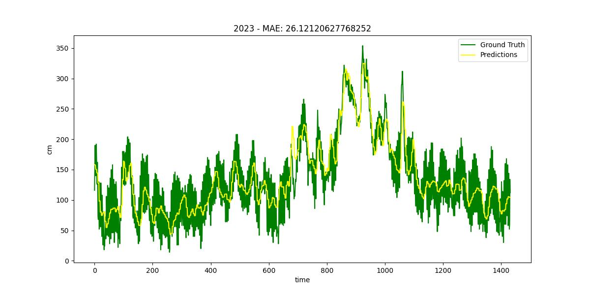
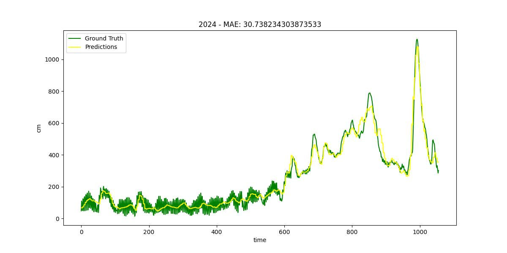

<div align="center">

# 🌊 Flood — Water Level Prediction

**Water level forecasting at Hanoi station using Transformer-based AI models**

[](http://vnjhm.vn/article/3837)
[](https://www.python.org/)
[](https://pytorch.org/)
[](https://lightning.ai/)
[](https://hydra.cc/)
[](https://wandb.ai/)

</div>

---

## 📖 Overview

This project predicts the water level at the **Ha Noi** gauge station on the Red River for the next **2 days** (8 timestamps, every 6 hours) from:

| Input group | History | Stations |
|---|---|---|
| 📍 **12 measuring stations** | 7 days (28 points) | Lao Cai, Vu Quang, Ha Giang, Bac Me, Vinh Tuy, Ham Yen, Tuyen Quang, Son Tay, Ha Noi, Chu, Pha Lai, Phu Tho |
| 💧 **5 discharge stations** | 9 days (36 points, covering the forecast window) | Yen Bai, Hon Dau, Thac Ba, Hoa Binh, Tuyen Quang |

🧠 The model is a **Transformer encoder–decoder**: station readings are linearly projected, enriched with month/day time embeddings and positional encoding, encoded separately for gauge and discharge inputs, then decoded into the forecast. Training uses PyTorch Lightning + Hydra (based on the [lightning-hydra-template](https://github.com/ashleve/lightning-hydra-template)). A `tide` experiment (no discharge conditioning) is also provided.

> 📄 **Publication:** this work is published at [http://vnjhm.vn/article/3837](http://vnjhm.vn/article/3837).

## 🗂️ Project Structure

```
Flood/
├── configs/          # Hydra configs (data, model, trainer, experiment: flood / tide)
├── src/
│   ├── data/         # Dataset & LightningDataModule (normalization, missing-value interpolation)
│   ├── models/       # FloodModule, TideModule and Transformer1D network
│   ├── train.py      # Training entry point
│   ├── inference.py  # Inference on an Excel file -> .csv / .xlsx / .jpg in results/
│   └── Flood.py      # Packaged API: Flood.calculate(...)
├── weights/          # Pretrained checkpoints + normalization metadata
└── results/          # Example inputs (week / month / year) and result plots
```

## ⚙️ Setup

### 1️⃣ Clone the repository

```bash
git clone https://github.com/huynhspm/Flood.git
cd Flood
```

### 2️⃣ Install required packages

```bash
conda create -n flood python=3.10
conda activate flood
pip install -e .
```

## 🚀 Usage as a Library

Once installed, you can import the package and call `calculate`:

```python
from Flood import calculate
```

<details>
<summary><b>📋 Function parameters</b></summary>

| Argument | Type | Length | Description |
|---|---|---|---|
| `lao_cai`, `vu_quang`, `ha_giang`, `bac_me`, `vinh_tuy`, `ham_yen`, `tuyen_quang`, `son_tay`, `ha_noi`, `chu`, `pha_lai`, `phu_tho` | `List[int]` | 28 | Water levels of measuring stations (7 past days × 4 timestamps/day) |
| `yen_bai`, `hon_dau`, `xa_thac_ba`, `xa_hoa_binh`, `xa_tuyen_quang` | `List[int]` | 36 | Water levels of discharge stations (9 days × 4 timestamps/day) |
| `timestamp` | `List[datetime.datetime]` | 36 | Timestamps (9 days × 4 timestamps/day), format `%Y-%m-%d %H:%M` |

**Returns:** `List[int]` of length **8** — water levels at the Ha Noi station for the 2 upcoming days (4 timestamps/day).

</details>

<details>
<summary><b>🧪 Example with fake data</b></summary>

```python
import Flood
from datetime import datetime, timedelta

times = ['01:00', '07:00', '13:00', '19:00']
start_date = datetime(2024, 1, 1)
timestamp = [datetime.strptime(f'{(start_date + timedelta(days=day_offset)).strftime("%Y-%m-%d")} {time}', '%Y-%m-%d %H:%M')
            for day_offset in range(9) for time in times]

water_level_1 = [i for i in range(28)]
water_level_2 = [i for i in range(36)]

output = Flood.calculate(lao_cai=water_level_1,
                        vu_quang=water_level_1,
                        ha_giang=water_level_1,
                        bac_me=water_level_1,
                        vinh_tuy=water_level_1,
                        ham_yen=water_level_1,
                        tuyen_quang=water_level_1,
                        son_tay=water_level_1,
                        ha_noi=water_level_1,
                        chu=water_level_1,
                        pha_lai=water_level_1,
                        phu_tho=water_level_1,
                        yen_bai=water_level_2,
                        hon_dau=water_level_2,
                        xa_thac_ba=water_level_2,
                        xa_hoa_binh=water_level_2,
                        xa_tuyen_quang=water_level_2,
                        timestamp=timestamp)

print(output)
```

</details>

## 🏋️ Training

Before starting training, configure the following environment variables:

- 🖥️ **`CUDA_VISIBLE_DEVICES`** — GPU(s) to use.
- 🔑 **`WANDB_API_KEY`** — required for Weights & Biases logging (replace `???` with your API key).

```bash
export CUDA_VISIBLE_DEVICES=0
export WANDB_API_KEY=???
python3 src/train.py experiment=flood

# or the variant without discharge stations
python3 src/train.py experiment=tide
```

📦 **Available checkpoints** in `weights/`:

| Checkpoint | Description |
|---|---|
| `not_training_2024.ckpt` | Flood model, 2024 held out |
| `training_2024.ckpt` | Flood model, 2024 included |
| `tide_not_training_2024.ckpt` | Tide model, 2024 held out |

## 🔮 Inference

Input data must follow the format of the example files (`week.xlsx`, `month.xlsx`, `year.xlsx`) in the `results/` folder. Outputs (`.csv`, `.xlsx`, `.jpg`) are saved to `results/`.

```bash
python3 src/inference.py --input <path_to_input_file> --ckpt <path_to_checkpoint_file>

# example
python3 src/inference.py --input results/year.xlsx --ckpt weights/not_training_2024.ckpt
```

## 📊 Results

<p align="center">
  
  
</p>

## 📝 Citation

This work is published at [http://vnjhm.vn/article/3837](http://vnjhm.vn/article/3837). If you find it useful, please cite:

```bibtex
@article{le2025water,
  title={Water level forecasting at Hanoi station using transformer-based AI models},
  author={Le An, Ngo and Long, Tran Quoc and Huynh, Trinh Ngoc and Son, Nguyen Hoang},
  year={2025}
}
```
